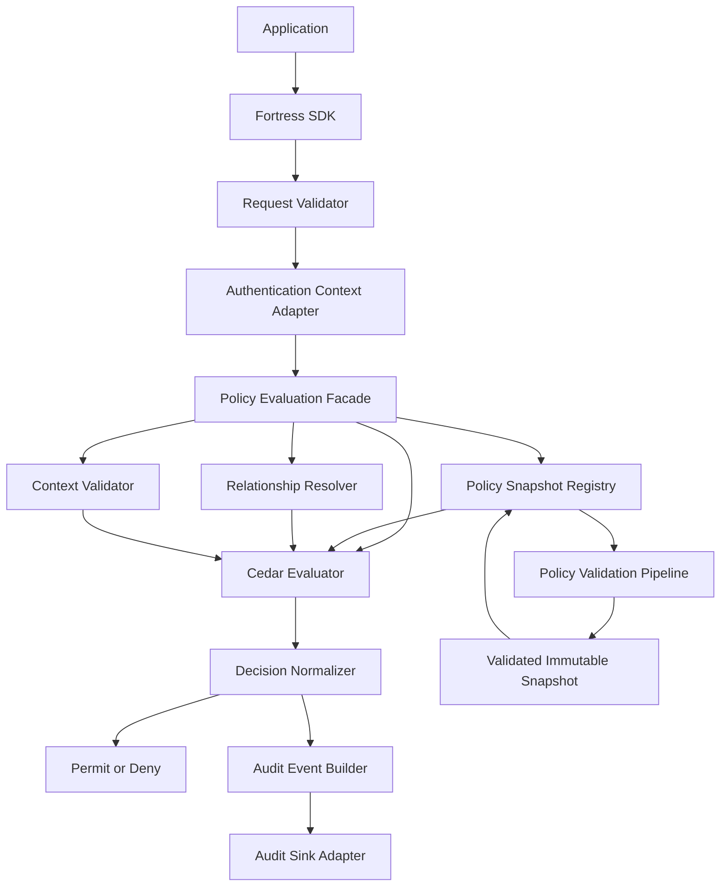
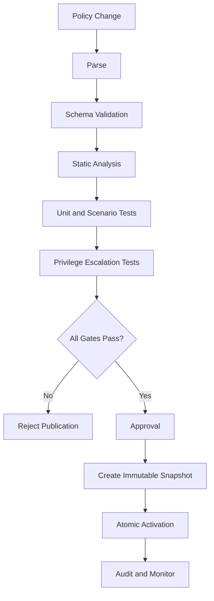

### FORTRESS — Secure Authorization Framework

Technical Specification · Rust · Embedded Library · Production Engineering Baseline

FORTRESS dirancang sebagai framework otorisasi tertanam yang dapat digunakan oleh aplikasi web, REST/GraphQL API, SaaS multi-tenant, sistem enterprise, dan microservices. Framework ini bukan sekadar pustaka RBAC, melainkan mesin pengambilan keputusan otorisasi dengan kebijakan yang dapat diverifikasi, isolasi tenant, kontrol akses istimewa, audit keamanan, dan integrasi yang konsisten.

Saya akan menetapkan rancangan dengan prinsip secure by default, explicit deny, least privilege, fail closed, dan defense in depth.

Ada batasan yang perlu ditegaskan: spesifikasi yang lengkap dapat menghilangkan ambiguitas desain, tetapi tidak dengan sendirinya menjadikan implementasi production-ready. Status produksi harus diperoleh setelah seluruh persyaratan, pengujian, audit, dan kriteria penerimaan dalam dokumen ini terpenuhi. Tidak ada dasar untuk mengklaim framework sudah tersertifikasi atau kebal terhadap serangan hanya dari rancangan.

Konstitusi teknis

Normatif, fail-closed, reproducible, dan dapat diaudit.

IMPLEMENTATION LANGUAGE

Rust

PRODUCT FORM

Embedded library

AUTHORIZATION MODEL

RBAC + ABAC + ReBAC

DEFAULT DECISION

Deny

### 1\. Identitas dan ruang lingkup

### 1.1 Tujuan produk

FORTRESS adalah library Rust untuk mengambil keputusan apakah suatu subject boleh melakukan action terhadap resource dalam context tertentu.

Model keputusan normatif:

D = P(S,A,R,C,E)

Keterangan:

* : subject, yaitu pengguna, service account, atau workload.

* : action, seperti `read`, `update`, `approve`, atau `delete`.

* : resource yang dilindungi.

* : context, seperti tenant, sesi, perangkat, dan lingkungan.

* : policy snapshot dan data hubungan yang digunakan untuk mengevaluasi keputusan.

* : keputusan otorisasi, termasuk `Permit`, `Deny`, atau `Indeterminate`.

`Indeterminate` berarti mesin tidak dapat mengambil keputusan secara aman, misalnya karena atribut wajib hilang atau sumber data gagal. Hasil ini tidak pernah boleh diperlakukan sebagai izin.

### 1.2 Cakupan wajib

* RBAC, ABAC, dan relationship-based authorization (ReBAC).

* Hak akses pada level resource, record, field, dan operasi.

* SaaS multi-tenant dengan batas tenant yang eksplisit.

* Hierarki role, permission, dan delegasi yang dibatasi.

* Separation of duties dan persetujuan multi-pihak.

* Akses istimewa dengan masa berlaku.

* Evaluasi policy deterministik dan tervalidasi.

* Audit keputusan dan perubahan kebijakan.

* Pencabutan akses dan pembatasan masa berlaku keputusan.

* Integrasi web, API, GraphQL, dan microservices.

* SDK, dokumentasi, migrasi versi, serta distribusi paket.

* Pengujian adversarial, fuzzing, dan verifikasi keamanan berkelanjutan.

### 1.3 Batas tanggung jawab

FORTRESS bertanggung jawab atas keputusan otorisasi. Ia tidak otomatis menggantikan:

* autentikasi, identity provider, dan MFA;

* pengelolaan kata sandi atau verifikasi identitas;

* enkripsi transport dan manajemen kunci;

* isolasi jaringan, sandbox, atau keamanan sistem operasi;

* otorisasi yang diterapkan langsung oleh database;

* mekanisme pencadangan dan pemulihan;

* prosedur operasional organisasi.

Framework menyediakan integrasi dan kontrol untuk sistem tersebut, tetapi setiap lapisan tetap harus dikonfigurasi dan diuji.

### 2\. Keputusan arsitektur yang dikunci

Agar implementasi tidak menghasilkan banyak interpretasi berbeda, keputusan berikut menjadi bagian dari konstitusi teknis.

| ID      | Keputusan wajib                                                                                                                               |
| ------- | --------------------------------------------------------------------------------------------------------------------------------------------- |
| ADR-001 | Produk berupa library Rust yang tertanam di proses aplikasi.                                                                                  |
| ADR-002 | Mesin policy menggunakan Cedar melalui Rust API, dibungkus dengan kontrak FORTRESS yang lebih ketat.                                          |
| ADR-003 | Model akses menggabungkan RBAC, ABAC, ReBAC, dan explicit deny.                                                                               |
| ADR-004 | Keputusan akhir hanya Permit atau Deny; kegagalan internal menghasilkan Deny dengan reason code internal Indeterminate.                       |
| ADR-005 | Tidak ada implicit allow, role superuser universal, atau bypass tersembunyi.                                                                  |
| ADR-006 | Identitas berasal dari autentikasi aplikasi atau identity provider tepercaya; FORTRESS tidak mempercayai identitas dari input pengguna biasa. |
| ADR-007 | Semua objek memiliki namespace dan tenant boundary yang eksplisit jika berlaku.                                                               |
| ADR-008 | Policy divalidasi sebelum dipublikasikan dan menggunakan immutable policy snapshot berversi.                                                  |
| ADR-009 | Semua API evaluasi menggunakan tipe data terstruktur, bukan ekspresi policy yang dirakit dengan string.                                       |
| ADR-010 | Operasi berisiko tinggi membutuhkan kontrol tambahan di luar izin biasa, misalnya persetujuan independen dan MFA yang masih valid.            |
| ADR-011 | Tidak ada network call tersembunyi di dalam fungsi evaluasi inti.                                                                             |
| ADR-012 | Keputusan yang dicache wajib tunduk pada versi policy, batas waktu, dan strategi pencabutan akses yang eksplisit.                             |

Cedar memiliki model principal-action-resource-context, validasi schema, dan semantik default-deny yang cocok untuk dijadikan fondasi evaluator. FORTRESS tetap perlu membangun kontrak integrasi, isolasi tenant, pengelolaan snapshot, audit, dan kontrol operasi di sekelilingnya.

Alasan tidak menulis evaluator policy baru dari nol: evaluator otorisasi adalah komponen keamanan kritis. Membungkus mesin yang sudah mempunyai model formal dan validasi schema mengurangi jumlah semantik keamanan yang harus diciptakan dan dipelihara sendiri. Cedar sendiri tetap memerlukan validasi implementasi dan konfigurasi aplikasi; ia bukan jaminan bahwa semua policy bisnis pasti benar.

### 2.1 Profil keamanan

FORTRESS mendefinisikan tiga profil konfigurasi, tetapi satu model semantik.

Profile Standard

Aplikasi web dan API biasa. Policy wajib tervalidasi, default-deny, audit keputusan, dan tenant isolation bila diperlukan.

Profile Hardened

Enterprise dan SaaS. Memerlukan audit terlindungi, kontrol perubahan policy, pembatasan privilege, revocation yang terdefinisi, serta pemantauan keamanan.

Profile Critical

Sistem berdampak tinggi. Mewajibkan persetujuan independen untuk operasi tertentu, kontrol kunci dan audit yang lebih ketat, pengujian adversarial, serta review keamanan formal sebelum rilis.

Profil yang lebih tinggi tidak boleh melonggarkan aturan profil di bawahnya. Perbedaan profil hanya menambah kontrol. Profil Critical bukan klaim sertifikasi militer.

### 3\. Arsitektur internal



### 3.1 Batas kepercayaan

* Aplikasi pemanggil bertanggung jawab atas autentikasi, pemuatan resource yang benar, dan penerapan keputusan.

* FORTRESS SDK memvalidasi bentuk request, tenant, action, resource, context, dan policy version.

* Evaluator hanya menjalankan policy yang telah tervalidasi.

* Relationship resolver memberikan data relasi yang terotorisasi dan konsisten; data relasi tidak boleh diambil dari klaim pengguna yang belum diverifikasi.

* Audit sink merupakan komponen terpisah. Kegagalan audit wajib menghasilkan status yang dapat dideteksi dan diputuskan menurut profil operasi.

* Database aplikasi tetap harus menegakkan batas akses data, terutama pada query multi-tenant dan operasi tulis.

FORTRESS tidak boleh menganggap keputusan `Permit` sebagai pengganti transaksi database yang aman. Pemeriksaan dan perubahan resource harus dirancang agar tidak menimbulkan time-of-check to time-of-use (TOCTOU).

### 3.2 Jalur evaluasi normatif

Setiap permintaan harus melewati urutan berikut:

* Validasi struktur request dan batas ukuran.

* Validasi identitas dan sumber autentikasinya.

* Validasi tenant dan identitas resource.

* Validasi action terhadap registry schema.

* Memilih policy snapshot yang aktif dan konsisten.

* Memuat atribut dan relasi yang diperlukan dari sumber tepercaya.

* Memvalidasi atribut wajib, tipe data, dan masa berlaku.

* Mengevaluasi policy.

* Menerapkan explicit deny dan aturan pembatas.

* Menormalisasi hasil menjadi `Permit` atau `Deny`.

* Menghasilkan audit event sesuai profil.

* Mengembalikan keputusan; aplikasi menegakkan keputusan tersebut sebelum operasi sensitif dijalankan.

Jika salah satu tahap yang diwajibkan gagal, hasilnya tidak boleh menjadi `Permit`.

### 4\. Konstitusi model akses

### 4.1 Entitas dan tipe data

Model domain harus memiliki entitas berikut.

| Entitas        | Fungsi                                                           |
| -------------- | ---------------------------------------------------------------- |
| Subject        | Pengguna, service account, workload, atau identitas non-manusia  |
| Role           | Kumpulan permission yang dapat diberikan melalui assignment      |
| Permission     | Hak semantik atas suatu action/resource                          |
| Action         | Operasi yang didefinisikan schema                                |
| Resource       | Objek atau record yang dilindungi                                |
| Tenant         | Batas isolasi organisasi                                         |
| Policy         | Aturan permit/forbid dan kondisi                                 |
| Relationship   | Relasi subject/resource/group yang diperlukan untuk keputusan    |
| Context        | Sesi, autentikasi, perangkat, waktu, risiko, dan konteks request |
| Decision       | Hasil evaluasi dan metadata keputusannya                         |
| PolicySnapshot | Kumpulan policy tervalidasi yang immutable                       |
| AuditEvent     | Rekaman keputusan atau perubahan keamanan                        |

Setiap ID adalah identifier bertipe, bukan string bebas yang dapat dipertukarkan. Misalnya `SubjectId` tidak boleh digunakan sebagai `TenantId` tanpa konversi eksplisit dan validasi.

Semua timestamp harus memiliki timezone atau direpresentasikan sebagai waktu UTC. Masa berlaku menggunakan interval setengah terbuka : valid pada `start`, tidak valid pada `end`.

### 4.2 Aturan role

Role bukan hak istimewa universal. Role hanya mengelompokkan permission.

Contoh:

* `support.read_ticket`

* `support.update_ticket`

* `billing.view_invoice`

* `billing.refund`

* `identity.manage_roles`

* `security.publish_policy`

Aturan wajib:

* Role baru tidak memberikan akses sebelum diberi permission.

* Role assignment harus mempunyai scope, issuer, dan masa berlaku sesuai kebutuhan.

* Pengguna tidak boleh menetapkan role untuk dirinya sendiri kecuali terdapat alur delegasi eksplisit yang secara independen mengizinkannya.

* Perubahan role atau permission harus melewati validasi policy dan pencatatan audit.

* Role hierarchy tidak boleh menciptakan privilege yang melampaui gabungan permission yang dideklarasikan.

* Hak istimewa lintas tenant tidak boleh diperoleh dari role tenant biasa.

* Nama role seperti `admin`, `owner`, dan `root` tidak mempunyai makna keamanan khusus tanpa policy.

### 4.3 Semantik keputusan

Semantik FORTRESS adalah:

* Semua request yang valid dimulai dari keputusan `Deny`.

* `Permit` hanya terjadi jika sedikitnya satu policy `permit` cocok dan tidak ada policy `forbid` yang cocok.

* Policy yang gagal dievaluasi tidak boleh memberikan izin.

* Jika ada atribut wajib yang tidak tersedia, bertipe salah, atau tidak dapat dipercaya, request menghasilkan `Deny`.

* Konflik antara izin dan larangan diselesaikan dengan kemenangan `forbid`.

* Policy snapshot yang tidak tervalidasi tidak boleh digunakan.

* Perubahan policy tidak berlaku sebagian. Snapshot baru dipublikasikan secara atomik.

* Kesalahan internal tidak boleh dikembalikan sebagai izin default.

Aturan ini mengadopsi pendekatan default-deny dan pemeriksaan izin pada setiap request yang direkomendasikan OWASP.

### 5\. Model policy

### 5.1 Struktur policy

Setiap policy harus mempunyai:

* `policy_id` yang unik dan stabil;

* `version`;

* `effect`: `permit` atau `forbid`;

* scope principal, action, dan resource;

* kondisi terstruktur;

* metadata pemilik dan alasan bisnis;

* status persetujuan;

* waktu pembuatan dan publikasi;

* schema version yang dipakai untuk validasi.

Contoh konseptual:

```cedar
permit (
    principal in App::Role::"support_agent",
    action == App::Action::"read_ticket",
    resource is App::Ticket
)
when {
    principal.tenant_id == resource.tenant_id &&
    resource.visibility == "support"
};
```

Contoh ini hanya berlaku jika schema dan entitas aplikasi benar-benar mendefinisikan atribut yang digunakan. Nama role atau atribut tidak boleh diasumsikan tersedia tanpa deklarasi schema.

### 5.2 Contoh explicit deny

```cedar
forbid (
    principal,
    action,
    resource
)
when {
    principal.account_status == "suspended"
};
```

Policy tersebut menunjukkan bahwa akun yang ditangguhkan tidak boleh melakukan tindakan yang dicakup oleh policy. Pada sistem nyata, cakupan ini perlu diselaraskan dengan pengecualian yang memang dibutuhkan, misalnya operasi pemulihan akun yang sangat terbatas.

### 5.3 Validasi sebelum publikasi

Setiap perubahan policy wajib menjalani pipeline:



Schema validation harus dilakukan sebelum policy diaktifkan, bukan hanya ketika keputusan akses dijalankan. Dokumentasi Cedar secara eksplisit merekomendasikan validasi policy terhadap schema dan menjelaskan risiko perubahan schema terhadap policy yang telah divalidasi.

Static analysis juga harus memeriksa:

* policy yang tidak mungkin cocok;

* izin yang terlalu luas;

* konflik antarkebijakan;

* privilege yang tidak diperlukan;

* policy yang tidak memiliki owner;

* policy tanpa test case;

* perubahan yang memperluas akses;

* perubahan schema yang membuat policy lama tidak valid.

### 6\. Kontrak API Rust

API publik harus konsisten, bertipe kuat, dan menghindari hasil boolean ambigu. Nama fungsi berikut merupakan kontrak rancangan; implementasi harus memenuhi semantik yang ditetapkan.

### 6.1 API utama

```rust
pub struct Authorizer { /* private fields */ }

pub struct AuthorizationRequest {
    pub subject: SubjectRef,
    pub action: ActionId,
    pub resource: ResourceRef,
    pub context: RequestContext,
}

pub enum Decision {
    Permit(DecisionMetadata),
    Deny(DenialMetadata),
}

impl Authorizer {
    pub fn authorize(
        &self,
        request: &AuthorizationRequest,
    ) -> Result<Decision, AuthorizationError>;
}
```

`Result` hanya digunakan untuk memisahkan kegagalan operasional dari keputusan. Tidak satu pun varian `Err` berarti izin. Adapter aplikasi wajib mengubah setiap error yang berhubungan dengan akses menjadi penolakan eksternal yang aman.

Untuk aplikasi yang menghendaki satu jalur keputusan tanpa penanganan `Result` sendiri, framework boleh menyediakan `authorize_or_deny`, tetapi fungsi tersebut harus mempertahankan reason code internal dan audit yang relevan.

### 6.2 API tambahan wajib

| API                 | Kontrak                                                             |
| ------------------- | ------------------------------------------------------------------- |
| authorize           | Mengevaluasi satu request                                           |
| authorize_batch     | Mengevaluasi batch tanpa mengubah semantik setiap request           |
| validate_policy     | Memvalidasi policy terhadap schema dan aturan FORTRESS              |
| prepare_snapshot    | Membuat snapshot tervalidasi tanpa mengaktifkannya                  |
| activate_snapshot   | Mengaktifkan snapshot secara atomik setelah kontrol publikasi lulus |
| current_snapshot    | Mengembalikan metadata versi snapshot aktif                         |
| explain_denial      | Memberikan alasan penolakan yang aman bagi caller yang berwenang    |
| check_access        | Adapter ringkas untuk middleware                                    |
| invalidate_subject  | Memulai pencabutan akses atau invalidasi cache subjek               |
| invalidate_resource | Menginvalidasi keputusan terkait resource yang berubah              |
| audit_status        | Melaporkan kesehatan mekanisme audit                                |

API publik tidak boleh menyediakan fungsi seperti `force_allow`, `skip_policy`, atau `disable_security_checks` dalam build produksi.

### 6.3 Contoh penggunaan

```rust
let request = AuthorizationRequest {
    subject: subject_ref,
    action: ActionId::new("read_ticket")?,
    resource: ticket_ref,
    context,
};

match authorizer.authorize(&request) {
    Ok(Decision::Permit(_)) => {
        // Lanjutkan hanya setelah resource dan tenant
        // tetap sesuai dengan request yang dievaluasi.
    }
    Ok(Decision::Deny(_)) | Err(_) => {
        // Tolak akses.
    }
}
```

Contoh tersebut menunjukkan kontrak penegakan akses, bukan implementasi lengkap. Tipe domain, validasi identitas, pemuatan resource, audit, dan error mapping harus ditentukan pada crate masing-masing.

### 6.4 Integrasi middleware

Middleware harus menerapkan aturan berikut:

* Autentikasi dilakukan sebelum otorisasi.

* Resource harus dimuat dari sumber tepercaya.

* Tenant ID dari URL atau body tidak boleh langsung dipercaya.

* Permission diperiksa pada setiap operasi yang dilindungi.

* `Permit` tidak boleh digunakan untuk resource berbeda dari resource yang dievaluasi.

* Operasi database dan penegakan tenant harus konsisten dengan keputusan.

* Response eksternal tidak boleh mengungkapkan policy internal atau informasi resource sensitif.

* Error internal harus memiliki correlation ID agar dapat ditelusuri tanpa membocorkan detail.

OWASP mengingatkan bahwa pemeriksaan yang hanya diterapkan pada sebagian jalur request tetap dapat membuka celah akses.

### 7\. Threat model — FORTRESS-THREAT-001

Threat model menggunakan pendekatan defense in depth dan prinsip Zero Trust: identitas atau perangkat tidak otomatis dipercaya karena berada di jaringan internal atau sudah memiliki sesi. Ini sejalan dengan NIST SP 800-207.

### 7.1 Aset yang harus dilindungi

| Aset                       | Risiko jika dikompromikan                                 |
| -------------------------- | --------------------------------------------------------- |
| Policy aktif               | Penyerang dapat mengizinkan akses yang seharusnya ditolak |
| Role assignment            | Privilege escalation                                      |
| Identitas dan klaim        | Pemalsuan subjek atau tenant                              |
| Resource attributes        | Akses ke record yang salah                                |
| Policy signing keys        | Pemalsuan artefak atau metadata kepercayaan               |
| Audit log                  | Penghapusan jejak atau penyamaran aktivitas               |
| Cache keputusan            | Izin lama tetap digunakan setelah pencabutan              |
| Schema dan action registry | Policy salah tipe atau terlalu luas                       |
| Supply chain               | Dependency berbahaya atau build yang dimodifikasi         |
| Snapshot registry          | Rollback ke policy rentan atau aktivasi parsial           |

### 7.2 Matriks ancaman dan mitigasi

Severity berikut adalah prioritas desain awal. Nilai akhir harus diperbarui setelah analisis risiko pada deployment yang sesungguhnya.

| ID   | Ancaman                      | Mitigasi wajib                                                                    |
| ---- | ---------------------------- | --------------------------------------------------------------------------------- |
| T-01 | Privilege escalation         | Least privilege, pemeriksaan delegasi, uji graf role dan permission               |
| T-02 | Cross-tenant access          | Tenant binding dari sumber tepercaya, tenant equality wajib, pengujian isolasi    |
| T-03 | IDOR/BOLA                    | Otorisasi setiap resource, bukan sekadar endpoint atau jenis resource             |
| T-04 | Policy injection             | Parser policy resmi, input terstruktur, tidak merakit policy dari string pengguna |
| T-05 | Policy terlalu luas          | Schema validation, static analysis, review dan approval perubahan                 |
| T-06 | Replay identitas atau sesi   | Validasi issuer/audience/expiry, session revocation, batas usia kredensial        |
| T-07 | Cache stale                  | Versi snapshot, TTL terbatas, invalidasi dan aturan kegagalan yang eksplisit      |
| T-08 | Audit tampering              | Append-only sink, akses terbatas, hash chaining, pemantauan integritas            |
| T-09 | Dependency compromise        | Lockfile, dependency review, provenance build, vulnerability scanning             |
| T-10 | Denial of service            | Batas ukuran, batas kompleksitas policy, timeout, rate limit, pembatasan batch    |
| T-11 | Race condition               | Snapshot immutable, atomic activation, concurrency tests                          |
| T-12 | Side-channel                 | Pesan error eksternal seragam, tidak membocorkan policy atau resource             |
| T-13 | Untrusted context            | Validasi asal, tipe, masa berlaku, dan integritas atribut                         |
| T-14 | Unauthorized policy rollback | Monotonic activation sequence dan rollback yang memerlukan otorisasi              |
| T-15 | Audit sink outage            | Deteksi kegagalan, fail-closed sesuai profil dan jenis operasi                    |
| T-16 | Incomplete enforcement       | Middleware terpusat, integrasi database, pengujian seluruh jalur akses            |

### 7.3 Model penyerang

FORTRESS harus diuji dengan asumsi penyerang dapat:

* mengirim request HTTP atau RPC yang dibuat khusus;

* mengubah ID resource dan tenant pada request;

* mencoba semua action yang diketahui;

* menggunakan role sah untuk tindakan di luar cakupan;

* mengirim atribut hilang, salah tipe, atau kedaluwarsa;

* mengulangi request dan memanfaatkan race condition;

* mencoba mengubah policy melalui akun berprivilege rendah;

* menyebabkan dependency atau audit sink tidak tersedia;

* membaca response error dan mengukur perilaku sistem.

Model ini tidak mengasumsikan penyerang telah menguasai proses Rust yang menjalankan FORTRESS. Jika proses aplikasi, host, atau memori proses telah dikuasai sepenuhnya, library tertanam tidak dapat menjamin enforcement terhadap penyerang yang mengendalikan proses tersebut. Untuk batas kepercayaan yang lebih kuat, deployment dapat menambahkan proses otorisasi terpisah dan proteksi infrastruktur.

### 7.4 Invarian keamanan

Berikut adalah kondisi yang wajib selalu benar:

* Tidak ada request yang menghasilkan `Permit` tanpa policy yang cocok dan tervalidasi.

* `forbid` yang cocok selalu mengalahkan `permit`.

* Tenant mismatch tidak pernah menghasilkan `Permit`.

* Identitas yang tidak tervalidasi tidak pernah dianggap sebagai subjek sah.

* Error evaluasi tidak pernah diinterpretasikan sebagai izin.

* Policy yang tidak tervalidasi tidak pernah diaktifkan.

* Perubahan role tidak dapat dilakukan oleh pihak yang tidak memiliki hak delegasi.

* Cache tidak dapat melewati masa berlaku atau aturan pencabutan yang ditetapkan.

* Keputusan untuk resource A tidak dapat dipakai untuk resource B.

* Perubahan policy aktif tidak menghasilkan snapshot campuran.

* Pengguna tidak dapat menghapus atau mengubah audit melalui hak yang hanya memberinya akses aplikasi biasa.

* Tidak ada jalur API produksi yang melewati pemeriksaan wajib.

Invarian ini harus diterjemahkan menjadi automated tests, bukan hanya dokumentasi.

### 8\. Struktur repositori final

Struktur berikut memisahkan domain, evaluator, integrasi, audit, policy lifecycle, dan tooling. Pemisahan ini membantu mengurangi kemungkinan perubahan satu komponen melemahkan komponen lainnya.

```text
fortress/
├── Cargo.toml
├── Cargo.lock
├── rust-toolchain.toml
├── rustfmt.toml
├── clippy.toml
├── deny.toml
├── .cargo/
│   └── config.toml
├── .github/
│   ├── workflows/
│   │   ├── ci.yml
│   │   ├── security.yml
│   │   ├── fuzz.yml
│   │   ├── release.yml
│   │   └── provenance.yml
│   └── CODEOWNERS
├── crates/
│   ├── fortress-core/
│   ├── fortress-policy/
│   ├── fortress-evaluator/
│   ├── fortress-schema/
│   ├── fortress-identity/
│   ├── fortress-context/
│   ├── fortress-relationships/
│   ├── fortress-snapshot/
│   ├── fortress-audit/
│   ├── fortress-cache/
│   ├── fortress-crypto/
│   ├── fortress-middleware/
│   ├── fortress-testkit/
│   ├── fortress-cli/
│   └── fortress-ffi/
├── integrations/
│   ├── axum/
│   ├── actix-web/
│   ├── tonic/
│   └── graphql/
├── schemas/
│   ├── core/
│   └── examples/
├── policies/
│   ├── examples/
│   └── test-fixtures/
├── tests/
│   ├── integration/
│   ├── authorization-matrix/
│   ├── tenant-isolation/
│   ├── privilege-escalation/
│   ├── revocation/
│   ├── concurrency/
│   ├── fail-closed/
│   └── compatibility/
├── fuzz/
│   ├── policy-parser/
│   ├── request-validator/
│   ├── snapshot-loader/
│   └── entity-resolver/
├── benches/
│   ├── authorize.rs
│   ├── batch.rs
│   ├── policy-load.rs
│   └── relationship-depth.rs
├── docs/
│   ├── specification/
│   ├── architecture/
│   ├── threat-model/
│   ├── security/
│   ├── operations/
│   ├── integration/
│   ├── adr/
│   └── compliance/
├── examples/
│   ├── basic-rbac/
│   ├── saas-multitenant/
│   ├── enterprise-approval/
│   └── microservices/
└── scripts/
    ├── verify-release.sh
    └── check-policy-coverage.sh
```

### 8.1 Batas tanggung jawab crate

| Crate                  | Tanggung jawab                                        |
| ---------------------- | ----------------------------------------------------- |
| fortress-core          | Tipe domain, keputusan, error, dan trait publik       |
| fortress-policy        | Parse, canonical representation, dan validasi policy  |
| fortress-evaluator     | Adapter evaluator Cedar dan normalisasi keputusan     |
| fortress-schema        | Action registry, entity types, schema version         |
| fortress-identity      | Validasi principal dan kontrak identity claims        |
| fortress-context       | Validasi context dan sumber atribut                   |
| fortress-relationships | Resolusi relasi dan pemeriksaan konsistensi           |
| fortress-snapshot      | Snapshot immutable, aktivasi, versioning              |
| fortress-audit         | Event schema, redaction, sink adapter, integritas     |
| fortress-cache         | Cache keputusan dengan aturan invalidasi              |
| fortress-crypto        | Abstraksi tanda tangan dan verifikasi artefak         |
| fortress-middleware    | Middleware aplikasi dan kontrak enforcement           |
| fortress-testkit       | Fixtures, property generators, dan assertion keamanan |
| fortress-cli           | Validasi policy, analisis, pemeriksaan release        |
| fortress-ffi           | Integrasi non-Rust yang diaktifkan secara eksplisit   |

Tidak semua crate harus memiliki dependensi ke semua crate lainnya. `fortress-core` tidak boleh bergantung pada adapter web, database, atau runtime tertentu.

### 8.2 Aturan dependency

* Dependency harus dicantumkan secara eksplisit dan dikunci.

* `unsafe` dilarang pada core kecuali ada pengecualian yang disetujui, terdokumentasi, dan diuji secara khusus.

* Tidak ada network I/O dalam fungsi evaluasi murni.

* Tidak ada evaluasi policy melalui shell atau dynamic code execution.

* Adapter opsional tidak boleh mengubah semantik keamanan core.

* Integrasi FFI harus memvalidasi pointer, ukuran, lifetime, dan error boundary.

* Build release harus reproducible dan menyertakan provenance.

* Setiap dependency baru harus memiliki justifikasi keamanan dan pemilik pemeliharaan.

### 9\. Model data dan konfigurasi

### 9.1 Konfigurasi dasar

Konfigurasi berikut adalah contoh bentuk konseptual. Implementasi harus menggunakan schema versioned dan deserialisasi yang menolak field wajib yang hilang, tipe salah, atau konfigurasi yang bertentangan.

```toml
[fortress]
profile = "hardened"
default_effect = "deny"
strict_schema = true
reject_unknown_actions = true
reject_unknown_fields = true

[policy]
require_validation = true
require_immutable_snapshot = true
require_approval_for_privilege_expansion = true

[tenant]
isolation_required = true
reject_missing_tenant = true

[audit]
required = true
redact_sensitive_attributes = true

[cache]
enabled = false
```

Konfigurasi cache dinonaktifkan sebagai baseline sampai implementasi dan pengujian invalidasinya memenuhi persyaratan keamanan. Ini bukan berarti cache selalu tidak aman; cache hanya boleh diaktifkan setelah semantik konsistensinya jelas.

### 9.2 Format keputusan

Setiap evaluasi menghasilkan keputusan yang memiliki struktur tetap:

```rust
pub struct DecisionMetadata {
    pub decision_id: DecisionId,
    pub policy_snapshot: SnapshotVersion,
    pub evaluated_at: Timestamp,
    pub valid_until: Option<Timestamp>,
}

pub struct DenialMetadata {
    pub decision_id: DecisionId,
    pub reason_code: DenialReasonCode,
    pub policy_snapshot: Option<SnapshotVersion>,
    pub evaluated_at: Timestamp,
}
```

`valid_until` tidak berarti aplikasi boleh mengabaikan perubahan resource atau pencabutan akses sebelum waktu tersebut. Keputusan hanya dapat digunakan dalam batas konsistensi yang dijamin deployment.

Reason code eksternal harus umum, misalnya `ACCESS_DENIED`. Detail seperti nama policy, role internal, atau atribut sensitif hanya tersedia untuk komponen diagnostik yang berwenang.

### 9.3 Audit event

Setiap event memiliki:

* `event_id`;

* `timestamp`;

* `event_type`;

* `decision_id`, jika berkaitan dengan evaluasi;

* identitas subject yang sudah dinormalisasi;

* action dan jenis resource;

* tenant scope, jika berlaku;

* versi snapshot dan schema;

* outcome dan reason code;

* correlation ID;

* sumber komponen;

* metadata integritas.

Jangan mencatat token autentikasi, password, private key, data pribadi yang tidak dibutuhkan, atau seluruh payload resource secara default.

Hash chaining dapat membantu mendeteksi perubahan pada log, tetapi tidak mencegah administrator yang menguasai seluruh sistem menghapus semua salinan log. Karena itu, audit berprofil tinggi memerlukan sink terpisah, akses yang dibatasi, dan pemantauan integritas independen.

### 10\. Pengujian keamanan dan verifikasi

FORTRESS tidak dinyatakan siap produksi hanya karena semua unit test lulus. Diperlukan pengujian semantik, integrasi, adversarial, supply chain, dan operasi.

### 10.1 Matriks pengujian

| Jenis                 | Tujuan                                                | Kriteria lulus                                                 |
| --------------------- | ----------------------------------------------------- | -------------------------------------------------------------- |
| Unit test             | Memverifikasi fungsi dan tipe inti                    | Semua test wajib lulus                                         |
| Policy semantic tests | Memverifikasi permit, forbid, dan default-deny        | Tidak ada hasil yang bertentangan dengan semantik              |
| Schema tests          | Mendeteksi policy/action/atribut salah                | Semua kasus invalid ditolak                                    |
| Property-based tests  | Menguji banyak kombinasi input                        | Tidak ditemukan pelanggaran invariant                          |
| Fuzzing               | Mencari panic, crash, parser bug, dan input berbahaya | Tidak ada bug yang belum ditriase                              |
| Differential tests    | Membandingkan adapter dengan evaluator referensi      | Tidak ada perbedaan yang tidak dijelaskan                      |
| Tenant isolation      | Mencoba akses lintas tenant                           | Semua kasus terlarang ditolak                                  |
| Privilege escalation  | Menguji role/delegasi dan perubahan policy            | Tidak ada eskalasi tanpa otorisasi                             |
| Concurrency tests     | Menguji perubahan snapshot dan request paralel        | Tidak ada snapshot campuran atau race yang melanggar invariant |
| Revocation tests      | Menguji pencabutan role/sesi/relasi                   | Memenuhi batas pencabutan yang dipublikasikan                  |
| Integration tests     | Menguji middleware dan data layer                     | Semua jalur sensitif menegakkan izin                           |
| Performance tests     | Mengukur latency dan throughput                       | Target yang telah disetujui terpenuhi                          |
| Recovery tests        | Memeriksa kegagalan dependency dan restart            | Tidak ada fail-open                                            |
| Supply-chain tests    | Memeriksa dependency dan artefak                      | Tidak ada temuan blocker yang belum diselesaikan               |

### 10.2 Property-based invariants

Pengujian otomatis harus mencakup setidaknya properti berikut:

Default-deny

Untuk request valid apa pun yang tidak cocok dengan policy `permit`, hasilnya harus `Deny`.

Forbid dominance

Menambahkan policy `forbid` yang cocok tidak boleh mengubah hasil `Deny` menjadi `Permit`.

Tenant isolation

Jika tenant subject berbeda dengan tenant resource pada operasi yang mensyaratkan tenant equality, hasilnya harus `Deny`.

Monotonic restriction

Menambahkan larangan yang cocok tidak boleh memperluas hak akses.

Snapshot consistency

Satu evaluasi hanya boleh menggunakan satu snapshot policy yang konsisten.

No stale privilege

Keputusan tidak boleh digunakan setelah batas masa berlaku atau pencabutan yang dijamin deployment terlampaui.

Resource binding

Keputusan untuk satu resource tidak boleh diterapkan pada resource lain tanpa evaluasi baru.

### 10.3 Fuzzing dan pengujian adversarial

Target fuzzing wajib mencakup:

* policy parser dan validator;

* serialisasi/deserialisasi request;

* batas ukuran dan kedalaman entity graph;

* snapshot loader;

* pemrosesan atribut;

* relasi melingkar;

* batch request;

* FFI boundary jika diaktifkan.

Pengujian adversarial harus memasukkan kombinasi atribut hilang, field duplikat, ID dengan format abnormal, tenant mismatch, policy yang saling bertentangan, perubahan schema, serta pergantian snapshot pada saat request berjalan.

Setiap temuan harus mempunyai severity, reproducer, owner, status perbaikan, dan regression test. Temuan Critical atau High yang belum terselesaikan menghalangi rilis produksi.

### 10.4 Supply chain dan kualitas kode

CI wajib menjalankan:

* `cargo fmt --check`;

* `cargo clippy --all-targets --all-features -- -D warnings`;

* unit dan integration tests;

* pemeriksaan dependency dan lisensi;

* audit kerentanan dependency;

* secret scanning;

* fuzzing berkelanjutan;

* pemeriksaan `unsafe`;

* pengujian dokumentasi dan contoh;

* SBOM dan provenance artefak rilis.

Build yang lolos CI belum membuktikan keamanan, tetapi build yang gagal pada salah satu gate wajib tidak boleh dipromosikan menjadi rilis.

### 11\. Target performa dan konsistensi

Karena FORTRESS adalah library tertanam, jalur evaluasi harus efisien tanpa mengorbankan semantik keamanan.

Target berikut merupakan sasaran rekayasa awal yang harus dibuktikan dengan benchmark, bukan hasil benchmark yang telah diukur.

| Metrik                                                     | Target awal                                                  |
| ---------------------------------------------------------- | ------------------------------------------------------------ |
| Warm authorization, policy lokal sederhana                 | p95 ≤ 1 ms                                                   |
| Warm authorization, policy dengan atribut dan relasi lokal | p95 ≤ 3 ms                                                   |
| Tambahan overhead wrapper di atas evaluator                | p95 ≤ 0,25 ms                                                |
| Evaluasi batch                                             | Throughput dan p95 diukur pada batch 1, 16, 64, dan 256      |
| Policy activation                                          | Atomik, tidak ada keadaan parsial                            |
| Cold start                                                 | Diukur pada beberapa ukuran snapshot                         |
| Memory footprint                                           | Diukur terhadap jumlah policy, entity, dan cache             |
| Revocation                                                 | Batas waktu terukur dan terdokumentasi untuk setiap strategi |
| Error handling                                             | Tidak ada fail-open pada fault injection                     |

Target latency di atas berlaku untuk evaluator lokal yang tidak melakukan network I/O. Resolusi data remote, autentikasi, database, dan audit sink berada di luar angka tersebut dan harus diukur secara terpisah.

Benchmark wajib mencatat CPU, RAM, OS, versi Rust, versi dependency, jumlah policy, distribusi kompleksitas policy, ukuran entity graph, warm/cold state, dan konfigurasi cache. Tanpa informasi itu, angka performa tidak dapat dibandingkan secara adil.

### 11.1 Strategi cache

Cache keputusan hanya dapat diaktifkan jika kunci cache mencakup seluruh dimensi yang memengaruhi keputusan, termasuk:

* subject dan identitas sesi yang relevan;

* action;

* resource;

* tenant;

* atribut context yang memengaruhi policy;

* snapshot policy;

* versi atau epoch relasi dan atribut yang relevan.

Jika ada dimensi yang tidak dapat diidentifikasi atau invalidasinya tidak dapat dijamin, hasil keputusan tidak boleh digunakan dari cache untuk operasi yang membutuhkan konsistensi kuat.

Untuk operasi sensitif, pendekatan default adalah evaluasi ulang terhadap sumber data tepercaya dan enforcement yang konsisten dengan transaksi.

### 12\. Pencabutan akses dan perubahan policy

Pencabutan akses adalah salah satu bagian paling penting dalam framework otorisasi produksi. Menghapus role dari database saja tidak cukup jika proses aplikasi masih menyimpan keputusan lama.

### 12.1 Jenis pencabutan

| Peristiwa                           | Respons wajib                                                                        |
| ----------------------------------- | ------------------------------------------------------------------------------------ |
| Pengguna dinonaktifkan              | Tolak request berikutnya setelah perubahan terkonfirmasi sesuai batas konsistensi    |
| Role dicabut                        | Invalidasi keputusan yang bergantung pada role tersebut                              |
| Keanggotaan tenant berubah          | Evaluasi ulang tenant binding dan relationship                                       |
| Resource dipindahkan ke tenant lain | Keputusan lama tidak boleh digunakan untuk tenant/resource baru                      |
| Policy berubah                      | Aktivasi snapshot baru secara atomik; request baru menggunakan snapshot yang berlaku |
| Sesi atau token dicabut             | Adapter autentikasi wajib memeriksa mekanisme revocation yang sesuai                 |
| Relasi dihapus                      | Keputusan yang bergantung pada relasi tersebut harus diperbarui                      |
| Kunci signing dicabut               | Tolak artefak baru yang ditandatangani dengan kunci yang tidak lagi dipercaya        |

### 12.2 Kontrak konsistensi

Setiap adapter sumber data harus mendokumentasikan salah satu tingkat berikut:

* Strong: perubahan terkonfirmasi sebelum request berikutnya dapat menggunakan state lama.

* Bounded-staleness: data lama dapat terlihat untuk batas waktu maksimum yang ditentukan.

* Eventual: perubahan dapat menyebar tanpa batas waktu deterministik yang dijamin; tidak memadai untuk operasi yang mensyaratkan pencabutan segera.

Operasi istimewa dan operasi berdampak tinggi tidak boleh menggunakan sumber eventual yang tidak memiliki batas konsistensi yang dapat diterima oleh kebijakan risiko.

Framework tidak boleh menjanjikan pencabutan instan secara universal tanpa mengendalikan sumber identitas, sumber relasi, proses aplikasi, dan semua cache yang berpengaruh pada keputusan.

### 13\. Operasi keamanan dan pemulihan

### 13.1 Policy signing dan activation

Jika policy dikirim sebagai artefak antarlingkungan, gunakan tanda tangan digital untuk memastikan asal dan integritas artefak.

Ketentuan:

* Algoritma dan format tanda tangan harus ditetapkan dalam dokumen kriptografi terpisah.

* Private key tidak disimpan di repositori atau di dalam file konfigurasi aplikasi.

* Kunci signing harus memiliki lifecycle, kontrol akses, rotasi, dan prosedur pencabutan.

* Artefak harus mencakup versi schema, identitas pembuat, versi snapshot, dan hash konten kanonis.

* Verifikasi tanda tangan tidak menggantikan validasi policy.

* Artefak yang gagal diverifikasi harus ditolak.

* Rollback memerlukan otorisasi eksplisit dan audit, bukan penurunan versi otomatis.

### 13.2 Perilaku saat komponen gagal

| Kegagalan                                 | Perilaku                                                                                                            |
| ----------------------------------------- | ------------------------------------------------------------------------------------------------------------------- |
| Policy snapshot tidak tersedia            | Tolak akses yang memerlukan snapshot tersebut                                                                       |
| Policy validator gagal                    | Jangan publikasikan snapshot                                                                                        |
| Relationship resolver gagal               | Tolak request yang membutuhkan relasi tersebut                                                                      |
| Atribut wajib hilang                      | Tolak request                                                                                                       |
| Audit sink gagal                          | Tolak operasi yang diwajibkan memiliki audit durable; untuk operasi lain, gunakan aturan profil yang terdokumentasi |
| Cache tidak tersedia                      | Jalankan evaluasi tanpa cache jika jalur sumber tepercaya tersedia; jika tidak, tolak                               |
| Snapshot baru invalid                     | Pertahankan snapshot aktif yang masih sah; jangan mengaktifkan snapshot invalid                                     |
| Tidak ada snapshot tepercaya saat startup | Jangan melayani operasi terlindungi                                                                                 |

Penting: mempertahankan snapshot lama hanya aman jika snapshot tersebut masih valid terhadap status keamanan terkini. Jika snapshot lama mengandung privilege yang sudah dicabut, sistem harus menolak operasi yang bergantung pada privilege tersebut, bukan mempertahankannya tanpa batas.

### 13.3 Observability

Framework wajib menyediakan metrik dan event untuk:

* jumlah keputusan permit dan deny;

* jumlah hasil indeterminate;

* latensi evaluasi;

* policy snapshot aktif;

* kegagalan validasi;

* invalidasi cache;

* keterlambatan revocation;

* kegagalan audit sink;

* perubahan policy dan role;

* jumlah request yang ditolak karena input invalid.

Metrik tidak boleh memasukkan token, secret, atau identifier sensitif ber-cardinality tinggi tanpa kebutuhan dan kontrol yang jelas.

### 14\. Kompatibilitas dan kontrak versi

FORTRESS harus mengelola versi API, policy schema, dan format snapshot secara terpisah.

| Komponen        | Aturan                                                                |
| --------------- | --------------------------------------------------------------------- |
| Public Rust API | Semantic Versioning; perubahan breaking memerlukan major version baru |
| Policy schema   | Versioned dan memiliki prosedur migrasi                               |
| Snapshot format | Memiliki version marker dan validasi kompatibilitas                   |
| Audit event     | Memiliki schema version agar konsumen log dapat berkembang            |
| SDK adapter     | Tidak boleh mengubah hasil otorisasi core                             |
| Feature flags   | Tidak boleh menjadi jalur untuk menonaktifkan kontrol wajib           |
| Deprecation     | Masa transisi dan versi penghapusan didokumentasikan                  |
| Security fix    | Memiliki advisory, affected versions, dan prosedur upgrade            |

Snapshot yang tidak kompatibel harus ditolak dengan error yang terukur. Jangan mencoba menafsirkan format baru dengan asumsi kompatibilitas.

### 15\. Kriteria penerimaan produksi

FORTRESS baru dapat diberi status Production Ready jika semua gate berikut lulus. Status ini harus dinyatakan berdasarkan bukti yang tersimpan dalam repositori dan laporan release.

### Production readiness checklist

0/10

Checklist ini untuk melacak hasil verifikasi, bukan bukti otomatis bahwa gate telah lulus.

G1 — Spesifikasi

Semua API, semantik keputusan, schema, dan perilaku kegagalan didefinisikan serta direview.

G2 — Implementasi

Semua fungsi publik dan fitur wajib selesai; tidak ada placeholder keamanan.

G3 — Semantik

Default-deny, forbid dominance, tenant isolation, dan snapshot consistency lulus automated tests.

G4 — Adversarial

Fuzzing, privilege escalation, IDOR/BOLA, revocation, concurrency, dan fault injection lulus.

G5 — Supply chain

Dependency, lisensi, secret scanning, SBOM, provenance, dan release integrity memenuhi kebijakan.

G6 — Performa

Benchmark reproducible memenuhi target pada mesin dan workload yang didokumentasikan.

G7 — Operasi

Recovery, key rotation, policy rollback, monitoring, dan incident response telah diuji.

G8 — Dokumentasi

Panduan integrasi, migrasi, threat model, API reference, dan hardening guide lengkap.

G9 — Review independen

Review keamanan independen selesai dan temuan Critical/High yang belum terselesaikan = 0.

G10 — Release

Artefak reproducible, changelog, security advisory process, dan rollback plan siap.

Salin checklist

Daftar tersebut tidak boleh ditafsirkan sebagai bukti bahwa FORTRESS sudah memenuhi gate. Pada tahap rancangan ini, gate harus dianggap belum terverifikasi sampai hasil implementasi dan laporan pengujian tersedia.

### 16\. Roadmap implementasi sampai rilis produksi

Targetnya bukan MVP dengan fitur dasar, melainkan satu siklus rekayasa penuh hingga rilis stabil. Tahapan di bawah adalah urutan ketergantungan teknis, bukan estimasi tanggal yang dijamin.

* Fase 1 — Specification Lock

    Kunci model domain, semantik permit/deny, tenant boundary, kontrak API, policy schema, threat model, dan ADR. Semua perilaku yang belum didefinisikan harus diselesaikan sebelum implementasi inti.

* Fase 2 — Secure Core

    Implementasikan tipe domain, adapter Cedar, request validator, schema registry, immutable snapshot, dan normalisasi keputusan. Tambahkan unit test dan property-based test sejak awal.

* Fase 3 — Full Authorization Model

    Selesaikan RBAC, ABAC, ReBAC, explicit deny, tenant isolation, separation of duties, privilege delegation, dan policy static analysis.

* Fase 4 — Lifecycle dan Integrasi

    Implementasikan policy publication, audit sink, revocation, cache invalidation, middleware web/API, dan adapter penyimpanan yang diperlukan.

* Fase 5 — Adversarial Verification

    Jalankan fuzzing, fault injection, concurrency tests, tenant isolation tests, privilege escalation tests, dan pengujian integrasi terhadap aplikasi contoh.

* Fase 6 — Production Hardening

    Selesaikan benchmark, supply-chain controls, reproducible build, SBOM, key lifecycle, observability, recovery drill, dan dokumentasi operasional.

* Fase 7 — Release Qualification

    Lakukan review independen, perbaiki seluruh blocker, verifikasi sepuluh production gates, bekukan kandidat rilis, lalu terbitkan versi stabil beserta bukti pengujian.

### 16.1 Dokumen yang harus menjadi sumber kebenaran

Repositori wajib mempunyai dokumen berikut sebagai single source of truth untuk setiap domainnya.

| Dokumen                | Isi wajib                                                      |
| ---------------------- | -------------------------------------------------------------- |
| SPEC.md                | Kontrak normatif seluruh framework                             |
| SECURITY_INVARIANTS.md | Invarian yang tidak boleh dilanggar                            |
| THREAT_MODEL.md        | Aset, ancaman, batas kepercayaan, mitigasi                     |
| POLICY_SEMANTICS.md    | Semantik permit, forbid, indeterminate, dan kombinasi policy   |
| API_CONTRACT.md        | API publik, tipe, error, dan jaminan kompatibilitas            |
| TENANT_ISOLATION.md    | Aturan isolasi dan pengujian lintas tenant                     |
| REVOCATION.md          | Batas konsistensi, cache, dan pencabutan akses                 |
| CRYPTOGRAPHY.md        | Tanda tangan, lifecycle kunci, dan format artefak              |
| TEST_PLAN.md           | Seluruh test suites dan kriteria kelulusan                     |
| RELEASE_GATES.md       | Persyaratan rilis dan bukti penerimaan                         |
| OPERATIONS.md          | Monitoring, recovery, rotasi kunci, dan incident response      |
| ADR/                   | Keputusan arsitektur, alasan, alternatif, serta konsekuensinya |

Jika implementasi bertentangan dengan kontrak keamanan, implementasi harus diperbaiki atau perubahan kontrak diproses melalui ADR dan review keamanan. Dokumentasi tidak boleh diubah diam-diam hanya untuk membuat test yang gagal terlihat lulus.

### 17\. Rekomendasi akhir

Saya merekomendasikan FORTRESS dibangun dengan lima prioritas yang tidak dapat ditawar:

* Semantik otorisasi yang benar terlebih dahulu. Jangan mengoptimalkan cache atau throughput sebelum seluruh keputusan permit/deny dapat dibuktikan konsisten.

* Policy engine yang tervalidasi. Gunakan Cedar sebagai evaluator awal, dengan schema ketat dan lapisan validasi tambahan yang menjadi tanggung jawab FORTRESS.

* Enforcement di seluruh jalur akses. Satu endpoint yang lupa melakukan pemeriksaan dapat membatalkan manfaat seluruh framework.

* Revocation dan tenant isolation sebagai fitur inti. Keduanya tidak boleh ditunda menjadi fitur tambahan setelah framework dipakai di produksi.

* Rilis berdasarkan bukti. Gunakan pengujian otomatis, laporan adversarial, benchmark reproducible, dan review independen sebelum menyatakan siap produksi.

Referensi teknis utama:

* NIST SP 800-207 — .

* Cedar Policy Language — .

* OWASP Authorization Cheat Sheet — .

Kesimpulan: rancangan ini memberikan kontrak teknis yang dapat dijadikan dasar implementasi framework otorisasi Rust untuk web, API, SaaS, enterprise, dan microservices. Namun, belum ada implementasi atau hasil pengujian dalam percakapan ini yang membuktikan status production-ready. Status tersebut baru sah setelah seluruh gate penerimaan terpenuhi dan hasilnya dapat diverifikasi.
